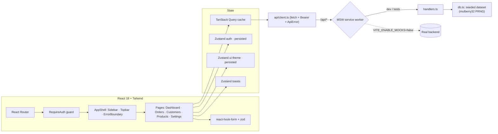

# ShopBD Admin Dashboard

React 18 back office for a Bangladeshi e-commerce operation: KPIs, orders, customers, product catalogue and settings, running entirely in the browser on a deterministic mock API.

[](https://github.com/AkibUllah/react-admin-dashboard/actions/workflows/ci.yml)


[](LICENSE)

## Why this exists

Every retail or POS backend I have built needed the same operations console on top of it: see today's numbers, find an order by number or phone, move it through its lifecycle, fix a product price. Those consoles tend to be written in a hurry and rot fast. This repository is the version I would start a client project from: the data-fetching, URL-driven table state, form validation, auth guard, theming and error handling are already solved, and because the API is mocked with MSW at the network level, the UI can be developed and demoed before the real backend exists and the same handlers double as test fixtures.

## Features

- Login with a fake JWT (expiry-aware), persisted session, route guards that return you to the page you asked for.
- Dashboard: four KPI cards with 30-day deltas, Recharts revenue area chart, orders-by-status breakdown, recent orders.
- Orders: server-style pagination, multi-column sorting, debounced search and status filter, all stored in the URL; detail modal with a status state machine (only valid transitions offered).
- Customers: lifetime value ranking, Dhaka/Chattogram/Sylhet addresses, BD phone numbers.
- Products: full CRUD in modal forms with react-hook-form + zod; prices entered in Taka and stored in paisa; server validation errors mapped back onto fields; delete confirmation.
- Settings: light/dark/system theme and a validated profile form.
- MSW 2 mock backend with a seeded PRNG dataset (480 orders, 120 customers, 28 products) so every reload shows the same data; artificial latency to exercise loading states.
- Dark mode, responsive off-canvas sidebar, toast notifications, skeleton loaders, error boundaries per route, inline API error panels with retry, 404 page.
- 42 Vitest + Testing Library tests, strict TypeScript, ESLint, CI on Node 18 and 20, nginx Dockerfile with SPA fallback and health endpoint.

## Architecture



Design decisions:

- **Server state vs client state.** Everything that comes from the API lives in TanStack Query (cache keys include list params, `keepPreviousData` keeps tables stable while paging). Only session, theme and toasts live in Zustand.
- **URL as the source of truth for lists.** Page, sort, search and filters are parsed from and serialised to the query string (`lib/queryParams.ts`), so views are shareable and the back button works. Defaults are omitted from the URL to keep it short.
- **Money in integer paisa.** The API and store never see floats; forms convert Taka ↔ paisa at the boundary (`productSchema.ts`).
- **Mocking at the network layer.** MSW intercepts `fetch`, so the API client, hooks and components are exercised exactly as in production. Tests use `msw/node` with the same handlers and zero latency.
- **Status transitions are data.** `orderTransitions.ts` is a small map of allowed moves; the modal renders options from it and the test asserts it.
- **Non-component exports live in their own modules** so Vite fast refresh stays reliable (enforced by the `react-refresh` ESLint rule).

## Tech Stack

| Area | Choice |
| --- | --- |
| UI | React 18.3, TypeScript 5.4 (strict), Tailwind CSS 3.4, lucide-react icons |
| Routing | React Router 6 (data router, nested layouts, guards) |
| Server state | TanStack Query 5 |
| Client state | Zustand 4 with `persist` |
| Forms | react-hook-form 7 + zod 3 (`@hookform/resolvers`) |
| Charts | Recharts 2 |
| Mock API | MSW 2 (browser worker in dev, node server in tests) |
| Tooling | Vite 5, Vitest 1, Testing Library, ESLint 8, PostCSS/Autoprefixer |
| Delivery | GitHub Actions (Node 18/20), nginx Docker image |

## Quick Start

Local:

```bash
git clone git@github.com:AkibUllah/react-admin-dashboard.git
cd react-admin-dashboard
npm ci
cp .env.example .env        # optional, defaults are fine
npm run dev                 # http://localhost:5173
```

Sign in with `admin@shopbd.test` / `password123` (also `manager@` and `support@` with the same password).

Docker (static build served by nginx on port 8080):

```bash
docker build -t shopbd-admin .
docker run --rm -p 8080:80 shopbd-admin
# http://localhost:8080  ·  health: http://localhost:8080/healthz
```

Pointing at a real backend: set `VITE_ENABLE_MOCKS=false` and `VITE_API_BASE_URL=https://api.example.com` (build args work for Docker too). The expected contract is the one implemented in `src/mocks/handlers.ts`.

## Usage

The mock API contract (all JSON, Bearer token required except login):

| Method | Path | Notes |
| --- | --- | --- |
| POST | `/api/auth/login` | `{ email, password }` → `{ token, user }` |
| GET | `/api/auth/me` | current user |
| GET | `/api/dashboard/summary` | KPIs, 30-day series, recent orders, status counts |
| GET | `/api/orders` | `page, pageSize, sort, order, q, status` → `Paginated<Order>` |
| GET / PATCH | `/api/orders/:id` | detail / `{ status }` |
| GET | `/api/customers` | `page, pageSize, sort, order, q` |
| GET / POST | `/api/products` | list / create (422 with field errors) |
| PUT / DELETE | `/api/products/:id` | update / remove |
| GET / PUT | `/api/settings/profile` | profile and notification flags |

Adding a page follows the same pattern everywhere:

```ts
// 1. a hook in src/api/queries.ts
export function useSuppliers(params: ListParams) {
  return useQuery({
    queryKey: ['suppliers', params],
    queryFn: ({ signal }) => api.get<Paginated<Supplier>>('/suppliers', params, signal),
    placeholderData: keepPreviousData,
  });
}

// 2. a page using useListQuery() + <DataTable> + <Pagination>
// 3. a handler in src/mocks/handlers.ts using listCollection()
// 4. a route in src/app/router.tsx and a NavLink in Sidebar.tsx
```

## Project Structure

```
react-admin-dashboard/
├── index.html
├── public/
│   ├── favicon.svg
│   └── mockServiceWorker.js      # MSW worker (generated)
├── src/
│   ├── main.tsx                  # starts MSW (dev) then mounts <App>
│   ├── App.tsx
│   ├── app/                      # providers, query client, router
│   ├── api/                      # types, fetch client, TanStack Query hooks
│   ├── components/
│   │   ├── layout/               # AppShell, Sidebar, Topbar, RequireAuth
│   │   ├── ui/                   # Button, Field, Modal, DataTable, Pagination, Toaster…
│   │   ├── charts/RevenueChart.tsx
│   │   └── ErrorBoundary.tsx
│   ├── features/
│   │   ├── auth/                 # LoginPage, loginSchema
│   │   ├── dashboard/            # DashboardPage, KpiCard
│   │   ├── orders/               # OrdersPage, OrderDetailModal, orderTransitions
│   │   ├── customers/
│   │   ├── products/             # ProductsPage, ProductFormModal, productSchema, stock
│   │   └── settings/
│   ├── lib/                      # env, format (BDT), queryParams, useListQuery, labels
│   ├── mocks/                    # db (seeded), handlers, collection, token, browser
│   ├── store/                    # auth, ui, toast (Zustand)
│   └── test/                     # vitest setup, msw node server, render helpers
├── docs/UI_WALKTHROUGH.md
├── Dockerfile · nginx.conf
└── .github/workflows/ci.yml
```

## Testing

```bash
npm test          # vitest run
npm run lint      # eslint + tsc --noEmit
npm run build     # tsc + vite build
```

42 tests across 9 files:

- `lib/format` – paisa→Taka with lakh/crore grouping, compact KPI amounts, percentages.
- `lib/queryParams` – URL parsing with clamping and defaults, round-trip serialisation.
- `store/*` – auth session and expiry, persistence, theme resolution, toast cap and auto-dismiss.
- `mocks/*` – PRNG determinism, dataset invariants (order totals, customer LTV, phone formats), `listCollection` filter/sort/paginate, fake JWT.
- `features/products/productSchema` – zod rules, Taka↔paisa conversion, order transitions, stock tone.
- Components – `ErrorBoundary` recovery, `RequireAuth` redirect, `DataTable` empty/loading/sort, `KpiCard`.
- Integration through MSW – login (validation, wrong password, success + redirect), orders list (first page, URL status filter, detail modal), product form (client errors, create, server-side duplicate SKU error).

A text UI walkthrough is in [docs/UI_WALKTHROUGH.md](docs/UI_WALKTHROUGH.md).

## Roadmap

- Role-based UI: hide destructive actions for `support`, read-only mode for `manager` on settings.
- Bulk actions on orders (export CSV, mark shipped) with optimistic updates.
- Column visibility and saved views per user.
- Bangla UI translation using `bangla-i18n` for numerals and dates.
- Playwright smoke test against the production build in CI.

## License

MIT, see [LICENSE](LICENSE).
